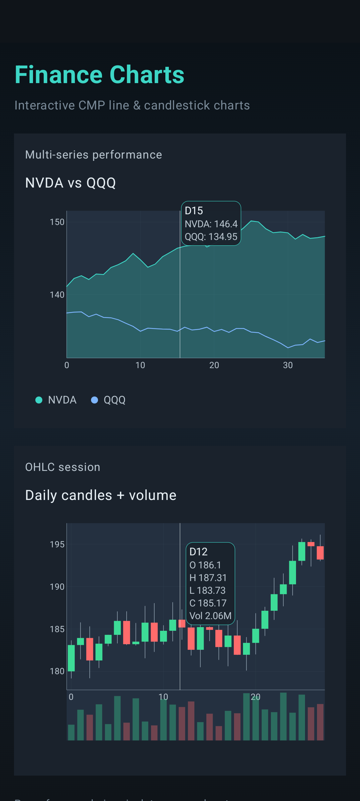
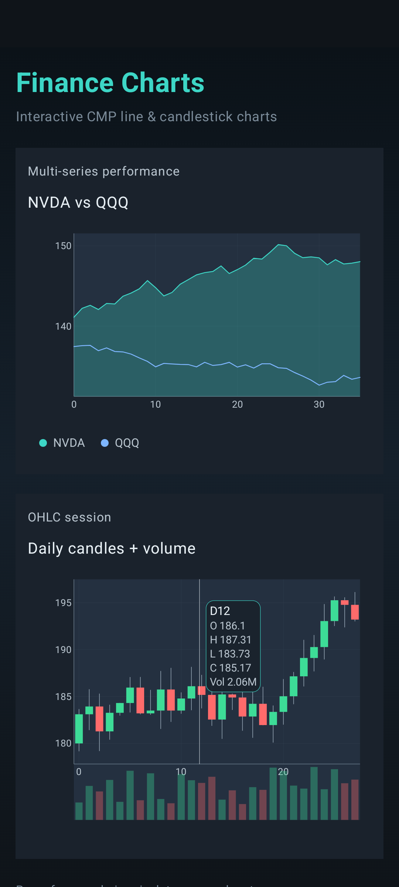

# Compose Finance Charts

Open-source **Compose Multiplatform** library for interactive financial charts — line/area and candlestick — shared across **Android** and **iOS**.

Built as a portfolio-depth presentation layer: design tokens, Canvas plotting, pan/zoom, crosshair tooltips, custom `Layout` / `SubcomposeLayout`, and entrance animations — not a full UI kit.

[](https://jitpack.io/#DwanZ/compose-finance-charts)

## Screenshots

Android sample — multi-series line/area, OHLC candles + volume, press for crosshair tooltips.

| Overview | Line crosshair | Candles + volume |
| :---: | :---: | :---: |
|  |  |  |

## Why this exists

Most mobile portfolio pieces stop at screens wired to a backend. This repo focuses on **Compose craft**: measurement, gestures, Canvas, and a tiny public API you can drop into a market or trading UI.

## Module map

```
compose-finance-charts/
  charts/     # KMP library (commonMain + android + ios)
  sample/     # Android demo app
  iosApp/     # Thin SwiftUI host (verify on a Mac)
```

## Install (JitPack)

```kotlin
// settings.gradle.kts
dependencyResolutionManagement {
    repositories {
        mavenCentral()
        maven(url = "https://jitpack.io")
    }
}

// module build.gradle.kts
dependencies {
    // JitPack multi-module coordinate (group = com.github.<user>.<repo>)
    implementation("com.github.DwanZ.compose-finance-charts:charts:1.0.0")
}
```

Artifact coordinates: `com.github.DwanZ.compose-finance-charts:charts:<tag>`  
(Local Maven: `com.github.DwanZ:charts:1.0.0` via `./gradlew :charts:publishToMavenLocal`.)

Tag a release (`git tag 1.0.0 && git push --tags`) and JitPack builds `:charts` via `jitpack.yml`.

## Quick start

```kotlin
@Composable
fun PortfolioSparkline() {
    LineChart(
        series = listOf(
            LineSeries(
                id = "price",
                name = "AAPL",
                points = listOf(
                    ChartPoint(0f, 178f),
                    ChartPoint(1f, 180f),
                    ChartPoint(2f, 176f),
                    ChartPoint(3f, 182f),
                ),
                showArea = true,
            ),
        ),
        title = "AAPL",
    )
}
```

Candles:

```kotlin
CandlestickChart(
    candles = SampleMarketData.candles(),
    title = "Session",
    showVolume = true,
)
```

## Run the Android sample

```bash
export ANDROID_HOME=~/Android/Sdk   # or your SDK path
./gradlew :sample:installDebug
# or build only:
./gradlew :sample:assembleDebug
```

Launch **Finance Charts** on an emulator/device. Press a plot for crosshair + tooltip; pinch to zoom; drag to pan.

## iOS verify (Mac only)

This Linux CI/agent environment cannot produce iOS binaries. On a Mac:

```bash
./gradlew :charts:linkDebugFrameworkIosSimulatorArm64
```

Then open `iosApp/` in Xcode, embed `Charts.framework` from the Gradle output, and run the simulator. Details: [`iosApp/README.md`](iosApp/README.md).

Shared UI entry: `MainViewController()` → `FinanceChartsDemo()`.

## Public API (v1)

| Type | Role |
|------|------|
| `LineChart` | Multi-series line/area + legend |
| `CandlestickChart` | OHLC + optional volume strip |
| `ChartPoint` / `Candle` / `LineSeries` | `@Immutable` models |
| `ChartStyle` / `FinanceTokens` | Visual system |
| `SampleMarketData` | Deterministic mock series |

## Interaction

- Pan / pinch-zoom (viewport clamped to data bounds)
- Crosshair + tooltip on press
- Semantic content descriptions + `testTag`s for UI tests

## Tests

```bash
./gradlew :sample:connectedDebugAndroidTest
# or library instrumented tests (device/emulator required):
./gradlew :charts:connectedDebugAndroidTest
```

## Publishing locally

```bash
./gradlew :charts:publishToMavenLocal
```

## License

MIT — see [LICENSE](LICENSE).
